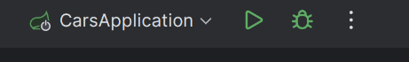
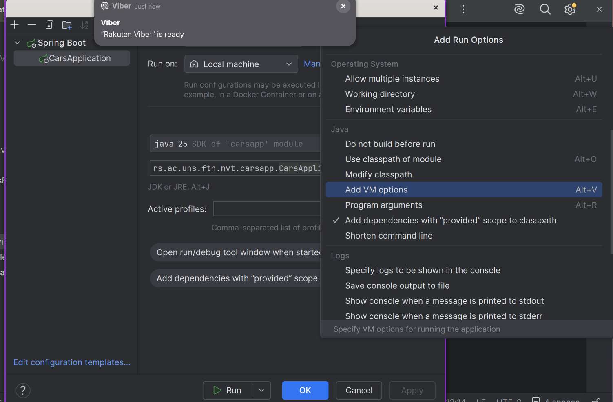
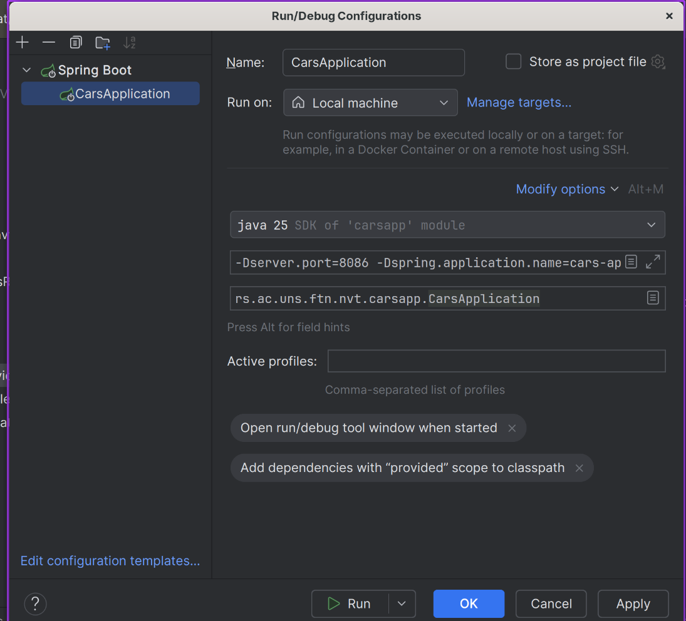

# Reverse proxy

Web aplikaciju mozete postaviti na neki server, te korisnici komuniciraju sa njom, direktno bez posrednika. Za male aplikacije i mali broj korisnika ovo je dovoljno dobro. Problemi se javljaju kada je neophodno podrzati veci broj korisnika, koordinirati interakciju vise servisa.

U opstem slucaju, klijentski kod (pa i sam korisnik) ne treba da zna tacno sa kojim serverom komunicira. Klijent treba da poznaje jednu adresu (simbolicku ili IP) koju gadja kako bi se ostvarila komunikacija. Pored apstrakcije interakcija korsinika sa celom infrastrutkurom, potencijalno se javlja potreba da kompletna infrastruktura usluga, kako web aplikacija tako i baze podataka, redova proluka, biva sakrivena od spoljnih korisnika. Ovo za cilj ima da omoguci izolaciju dodatnih servisa od korisnika, kako ne bi postajala mogucnost da se ostvari komunikacija sa privatnom infrastrukturom.

Pored uproscavanja interakcije korisnika sa servisima aplikacije, neophodno je sprovesti i balansiranje opterecenja. Balansiranje opterecenja podrazumeva automatsko rutiranje saobracaja koji je namenjen jednom servisu na vise istih servisa. Ovime se postize da jedan singularan servis ne biva opterecen (odnosno bombardovan) zahtevima, te se celokupni saobracaj raspodeli na vise instanci. 

## Nginx

Jedna od reverse proxy tehnologija. Poseduje svoju sintaksu koju treba ispostovati, koja definise pravila i logiku rutiranja zahteva. Ova pravila se mogu definisati u okviru jednog konfiguracionog file-a, te se on moze proslediti nginx-u prilikom njegovog pokretanja.

Nginx je ustanju da sprovede efektivno rutiranje zahteva da definisanih servisa, kao i da podrzi mehanizam balansiranja opterecenja. Pored toga, kako bi svi korisnici imali jednako iskustvo prilikom koriscenja korisnickog interfejsa ili prikaza statickih resursa, putem nginx mozete servirati korisnicki interfejs aplikacije (izgradjeni interfejs u obliku html/js/css).

## Instalacija

Da biste instalirali Nginx lokalno neophodno je da ga preuzmete putem orignalnog veb sajta:

```text
https://nginx.org/en/download.html
```

ili ako ste na Linuxu pozovete vas _package manager_, odnosno ako koristite _dnf_.

```bash
sudo dnf install nginx
```

Ili ako koristite _apt_

```bash
sudo apt install nginx
```

Nakon sto zavrsi neophodno je da pokrene Nginx kao servis. Na Linux-u se navedeno obavlja kao:

```
sudo systemctl start nginx 
```

Nakon ovoga nginx bi treba da bude spreman za pokretanje.

## Upravljanje konfiguracijom

Podrazumevano ponasanje Nginx-a je da preuzme `.conf` datoteku iz predefinanog direktorijuma, odnosno mesta gde je on instaliran. U slucaju sa Linux-om, to je najcesce `/etc/nginx/nginx.conf`. Ovo bi podrazumevalo da vasu konfiguraciju prenesete u ovaj folder, te kada pokrenete nginx on nju pokupi i ucita, odnosno pokrente komandu:

```bash
sudo nginx
```

Radi lakseg koriscenja, mozete proslediti apsolutnu putanju putem `-c` flag-a, odnosno:

```bash
sudo nginx -c "/apsolutna_putanja_do_konfiguracije"
```

Ili jos lakse ako ste terminal otvorili u istom direktorijumu gde je konfiguracija:

```bash
sudo nginx -p "$(pwd)" -c ime_moje_konfiguracije.conf
```

Da biste nginx zaustavili, ponovo pokrenuli, ugasili ili testirali konfiguraciju, koristite sledece komande:

```bash
sudo nginx -s reload       # ponovo učitava konfiguraciju
sudo nginx -s stop         # brzo zaustavljanje
sudo nginx -s quit         # graceful zaustavljanje
sudo nginx -t              # provera sintakse konfiguracije
```

Da biste pokrenuli drugu konfiguraciju, **neophodno je da provobitno zaustavite Nginx**. U suprotnom cete dobiti poruku o gresci da je port vec zauzet.

## Primer

### Setup

U primeru ovih vezbi, dostavljena vam je konfiguracija Nginx-a, aplikacija o vozilima, docker-compose, kao i interfejs sadrzan u `view/index.html`.

U nastavku je opisano lokalno pokretanje: Nginx je instaliran na vasoj masini, a aplikacije se pokrecu iz razvojnog okruzenja. Pokretanje istog primera u potpunosti unutar Docker-a opisano je u sekciji [Docker](#docker).

Za lokalno pokretanje neophodan vam je Postgres na `localhost:5432` sa bazom `carsdb`. Korisnicko ime i lozinku uskladite sa vrednostima u `carsapp/src/main/resources/application.properties`.

U `nginx.conf`, u okviru `location /`, promenite `root` na apsolutnu putanju do `view` foldera na vasoj masini.

Pokrenite Nginx sa prosledjenom konfiguracijom, i navigirajte se u pretrazivacu na `http://localhost:8787`. Ovde ce vam biti serviran `index.html`.

Neophodno je da pokrenete serverske aplikacije. Aplikaciju u vozilima treba da pokrenete dva puta sa razlicitim portovima i imenima. Ovo mozete sprovesti u razvojnom okruzenju `Intelij IDEA` tako sto specificirate parametre unutar konfiguracije u gornjem desnom uglu, pored dugmadi za porketanje, debug i zaustavljanje. Neophodno je otvorite prozor za izmenu konfiguracije, odnosno `klik na tri tackice -> Edit...`



Kada vam se otvori prozor da izmeniti konfiguraciju, u sekciji `VM Options` (ako je nema kliknite na segment `Modify options` te onda selektujte `Add VM Options`).




Da biste unutar `VM Options` sepcificirali unutar vase konfiguracije, odnostno port i ime aplikacije, mozete to uraditi na sledeci nacin:

```text
-Dserver.port=8086 -Dspring.application.name=cars-api-primary
```

Ovo treba da izlgeda ovako:



Napravite drugu konfiguraciju i zadajte joj ime. U ovoj konfiguraciji unutar sekcije `VM Options` cete ponovo zadati port i ime na sledeci nacin:

```text
-Dserver.port=8087 -Dspring.application.name=cars-api-secondary
```

### Demonstracija

Samu konfiguraciju Nginx, sadrzanu u nginx.conf, mozete analizirati. Pojedini segmenti su pokriveni komentarima kao objasnjenje sintakse i funkcionalnosti. Glavne funkcionalnosti su demostrirane kroz korisnicki interfejs, odnosno datoteku `index.html` unutar `view` foldera.

Klikom na dugme `Show cars` prikazani ce biti svi automobili sadrzani u bazi podataka, sa dodatnom kolonom koja ce ispisati i ime servera koji je opsluzio zahtev. Klijentska aplikacija pritom gadja jednu adresu (`/carsapi`), a nginx zahtev rutira na `carsapp`. Pored demonstracije korektnog rutiranja na `carsapp` instancu, ovaj primer demonstrira i balansiranje opterecenja, time sto uporednim klikovima na dugme `Show cars` u tabeli ce vam biti prikazano razlicito ime servera koji je opsluzio zhatev.

```javascript
const response = fetch('/carsapi/cars').then(response => {
   // super zanimljiva logika parsiranja u redove tabele :)
});
```

# Docker

Kada aplikaciju razvijate lokalno, ona radi na vašem racunaru sa vašim verzijama jezika, biblioteka i alata. Kada istu aplikaciju prebacite na drugi računar ili server, često se javljaju problemi: različite verzije programskih jezika i biblioteka, nedostajuće zavisnosti, drugačiji operativni sistem. Poznata izjava "kod mene radi" (_works on my machine_) je upravo posledica ovoga.

**Docker** rešava ovaj problem tako što aplikaciju pakuje zajedno sa svim što joj je potrebno za rad (runtime, biblioteke, konfiguracija) u jedinstvenu celinu koja se izvršava isto na bilo kom računaru koji ima instaliran **Docker**.

Pored toga, **Docker** omogućava da se više servisa (web aplikacija, baza podataka, red poruka, _reverse proxy_) pokrene na istom računaru, međusobno izolovani, bez potrebe da se bilo koji od njih instalira direktno na operativni sistem.

U prethodnom delu ste primer pokrenuli lokalno: instalirali ste Nginx, pokrenuli Postgres i dva puta pokrenuli aplikaciju iz razvojnog okruženja. U nastavku je isti primer pokrenut u potpunosti unutar Docker-a, jednom komandom.

## Osnovni pojmovi

**Image (slika)** je šablon, odnosno _read-only_ paket koji sadrži aplikaciju i sve što joj je potrebno. _Image_ se ne izvršava, već se iz njega kreiraju kontejneri.

**Container (kontejner)** je pokrenuta instanca _image-a_. Iz jednog _image-a_ možete pokrenuti više kontejnera, odnosno više nezavisnih instanci iste aplikacije.

**Dockerfile** je tekstualna datoteka koja opisuje korake izgradnje _image-a_. Sadrži instrukcije koje su neophodne da bi se kreirala slika, sa svojim _file_ sistemom, zavisnostima i konfiguracijom.

**Registry** je mesto gde se image-i čuvaju i odakle se preuzimaju. Najpoznatiji je [Docker Hub](https://hub.docker.com), odnosno _Docker-ov_ oficijalni registar. Moguće je povlačiti slike i sa drugih registara, pa čak imati i vaš lokalni registar (alat _Artifactory_).

**Volume** je mehanizam za trajno čuvanje podataka. Podaci unutar kontejnera nestaju kada se kontejner obriše, pa se, na primer, podaci baze podataka čuvaju u volumenima.

**Network (mreža)** omogućava kontejnerima da komuniciraju jedni sa drugima, i to preko imena servisa umesto IP adresa. Ovo omogućava komunikaciju između servisa u _Docker_ okruženju, moguće ju je specificirati unutar `docker-compose.yml` fajla.

Razlika u odnosu na virtuelne mašine je u tome što kontejneri ne nose sa sobom ceo operativni sistem, već dele jezgro (kernel) domaćina. Zbog toga su znatno lakši i brzi za pokretanje.

## Instalacija Docker-a

Docker možete preuzeti sa originalnog veb sajta:

```text
https://docs.docker.com/get-docker/
```

Na Windows-u i macOS-u instalirate **Docker Desktop**, koji sadrži sve neophodno, uključujući i `docker compose`.

Na Linux-u možete pratiti zvanično uputstvo za vašu distribuciju, a na Ubuntu/Debian sistemima:

```bash
sudo apt install docker.io docker-compose-v2
```

Ili ako koristite _dnf_ (Fedora), prateći zvanično uputstvo za dodavanje Docker repozitorijuma.

Nakon instalacije neophodno je da pokrenete Docker servis:

```bash
sudo systemctl start docker
sudo systemctl enable docker   # automatsko pokretanje pri startu sistema
```

Da biste Docker komande mogli da pozivate bez `sudo`, dodajte svog korisnika u `docker` grupu (potrebno je da se odjavite i ponovo prijavite):

```bash
sudo usermod -aG docker $USER
```

Instalaciju možete proveriti komandom:

```bash
docker run hello-world
```

## Osnovne komande

Preuzimanje image-a sa registry-ja:

```bash
docker pull nginx
```

Pokretanje kontejnera:

```bash
docker run nginx
```

Ovo će blokirati terminal. Ako to ne želite, koristite `-d` (_detached_) flag. Pored toga, najčešće želite da mapirate port kontejnera na port vašeg racunara pomoću `-p` flag-a (`-p <port_domacina>:<port_kontejnera>`) i da kontejneru zadate ime pomoću `--name`:

```bash
docker run -d -p 8080:80 --name moj-nginx nginx
```

Nakon ovoga, ako u pretraživaču odete na `http://localhost:8080`, videćete početnu stranu Nginx-a.

Prosledjivanje promenljivih okruženja (na primer za bazu podataka):

```bash
docker run -d -p 5433:5432 --name moja-baza \
  -e POSTGRES_USER=postgres \
  -e POSTGRES_PASSWORD=root \
  -e POSTGRES_DB=carsdb \
  postgres:15-alpine
```

Za pregled i upravljanje kontejnerima koristite sledeće komande:

```bash
docker ps                    # prikaz pokrenutih kontejnera
docker ps -a                 # prikaz svih kontejnera (i zaustavljenih)
docker logs moj-nginx        # ispis logova kontejnera
docker logs -f moj-nginx     # pracenje logova uzivo
docker stop moj-nginx        # zaustavljanje kontejnera
docker start moj-nginx       # ponovno pokretanje
docker rm moj-nginx          # brisanje kontejnera (mora biti zaustavljen)
docker rm -f moj-nginx       # brisanje i pokrenutog kontejnera
docker exec -it moj-nginx sh     # otvaranje terminala unutar kontejnera
docker images                # prikaz preuzetih image-a
docker rmi nginx             # brisanje image-a
```

Ako dobijete poruku da je port već zauzet, ili da kontejner sa tim imenom već postoji, neophodno je da prvo zaustavite i obrišete postojeći kontejner, ili da izaberete drugi port odnosno ime.

## Dockerfile

Kako biste od sopstvene aplikacije napravili image, neophodno je da napišete `Dockerfile`.

Najvažnije instrukcije:

| Instrukcija          | Opis                                                        |
| -------------------- | ----------------------------------------------------------- |
| `FROM`               | Osnovni image na osnovu koga se gradi novi                  |
| `WORKDIR`            | Radni direktorijum za sve naredne instrukcije               |
| `COPY`               | Kopira datoteke sa vaseg racunara u image                   |
| `RUN`                | Izvrsava komandu prilikom **izgradnje** image-a             |
| `ENV`                | Postavlja promenljivu okruženja                             |
| `EXPOSE`             | Dokumentuje koji port aplikacija koristi                    |
| `ENTRYPOINT` / `CMD` | Komanda koja se izvršava prilikom **pokretanja** kontejnera |

### Dockerfile aplikacije o vozilima

Dockerfile za aplikaciju o vozilima nalazi se u `carsapp/Dockerfile`:

```dockerfile
# Faza 1: build - kompajlira aplikaciju i pravi .jar
FROM maven:3.9-eclipse-temurin-17 AS build
WORKDIR /app
COPY pom.xml .
RUN mvn -q dependency:go-offline
COPY src ./src
RUN mvn -q package -DskipTests

# Faza 2: runtime - samo JRE i izgradjeni .jar
FROM eclipse-temurin:17-jre
WORKDIR /app
COPY --from=build /app/target/*.jar app.jar
ENTRYPOINT ["java", "-jar", "app.jar"]
```

Ovaj Dockerfile koristi tzv. _multi-stage build_, odnosno izgradnju u dve faze.

**Faza 1 (build)** služi samo da bi se od izvornog koda napravio `.jar`:

- `FROM maven:3.9-eclipse-temurin-17 AS build` zadaje osnovnu sliku koja već sadrži Maven i JDK 17. Zahvaljujući tome, ni Java ni Maven ne moraju biti instalirani na vašem računaru. Ključna reč `AS build` daje ime fazi, kako bi se kasnije mogla referencirati.
- `WORKDIR /app` postavlja radni direktorijum unutar slike. Sve naredne instrukcije se izvršavaju relativno u odnosu na njega.
- `COPY pom.xml .` i `RUN mvn -q dependency:go-offline` prvo kopiraju samo `pom.xml` i preuzimaju zavisnosti. Ovo je namerno: svaka instrukcija pravi jedan sloj (_layer_), a Docker ponovo koristi sloj iz keša ako se ništa nije promenilo. Zavisnosti se menjaju retko, a kod često, pa se one ne preuzimaju ispočetka pri svakoj izmeni koda.
- `COPY src ./src` tek nakon toga kopira izvorni kod. Izmena koda poništava keš samo od ove tačke nadalje.
- `RUN mvn -q package -DskipTests` pravi izvršni `.jar`. Testovi se preskaču, jer zahtevaju bazu podataka koja tokom izgradnje slike nije dostupna.

**Faza 2 (runtime)** je slika koja se zaista pokreće:

- `FROM eclipse-temurin:17-jre` započinje novu, čistu sliku koja sadrži samo JRE. Sve iz prve faze (Maven, JDK, izvorni kod, preuzete zavisnosti) se odbacuje, pa je finalna slika znatno manja.
- `COPY --from=build /app/target/*.jar app.jar` kopira samo gotov `.jar` iz faze `build`.
- `ENTRYPOINT ["java", "-jar", "app.jar"]` je komanda koja se izvršava pri pokretanju kontejnera.

Primetite da Dockerfile ne sadrži ni port, ni ime aplikacije, ni parametre baze. Ista slika se koristi za obe instance aplikacije, a ono po čemu se instance razlikuju zadaje se prilikom pokretanja, kroz promenljive okruženja.

Image se gradi komandom (poslednji argument je direktorijum u kome se nalazi Dockerfile):

```bash
docker build -t carsapp:1.0 ./carsapp
```

Ovu komandu ne morate pozivati ručno, jer Docker Compose sliku izgrađuje sam (ključ `build` u `docker-compose.yml`).

Pored Dockerfile-a nalazi se i `carsapp/.dockerignore`, koji radi isto što i `.gitignore`: navodi datoteke i foldere koji se ne šalju Docker-u prilikom izgradnje (na primer `target` i `.idea`), što ubrzava izgradnju.

Za Nginx i Postgres ne pišemo Dockerfile, jer se koriste gotove slike sa Docker Hub-a (`nginx:1.27-alpine` i `postgres:15-alpine`). Njih prilagođavamo isključivo kroz konfiguraciju u `docker-compose.yml`.

## Volume-i

Podaci unutar kontejnera su privremeni. Kada obrišete kontejner baze podataka, nestaju i svi podaci. Kako bi se podaci sačuvali, koristi se volume:

```bash
docker volume create app-data
docker run -d --name moja-baza \
  -v app-data:/var/lib/postgresql/data \
  -e POSTGRES_PASSWORD=root \
  postgres:15-alpine
```

Sada možete obrisati i ponovo kreirati kontejner, a podaci će ostati sačuvani u volume-u `app-data`.

Možete takođe mapirati i datoteku ili folder sa vašeg računara (_bind mount_), na primer neku konfiguraciju. Upravo tako se u ovom primeru Nginx kontejneru prosleđuje `nginx.conf`:

```bash
docker run -d --name moj-nginx -p 8787:8787 \
  -v "$(pwd)/nginx.conf:/etc/nginx/nginx.conf:ro" \
  nginx:1.27-alpine
```

Sufiks `:ro` označava da kontejner može samo da čita datoteku (_read-only_).

## Mreže

Kontejneri koji se nalaze u istoj korisnički definisanoj mreži mogu komunicirati putem imena kontejnera, umesto putem IP adresa:

```bash
docker network create app-net
docker run -d --name moja-baza --network app-net -e POSTGRES_PASSWORD=root postgres:15-alpine
docker run -d --name app --network app-net carsapp:1.0
```

Unutar `app` kontejnera, bazi se pristupa na adresi `moja-baza:5432`.

Treba imati na umu da `localhost` unutar kontejnera oznacava **sam kontejner**, a ne vaš računar. Ovo je česta greška prilikom konfiguracije konekcije ka bazi podataka: aplikacija koja radi u kontejneru mora da gađa ime servisa baze (na primer `postgres`), a ne `localhost`.

## Docker Compose

Pokretanje svakog servisa zasebno, uz sve flag-ove, vrlo brzo postaje nepregledno. Zbog toga se koristi **Docker Compose**. U jednoj `docker-compose.yml` datoteci opisuje se cela infrastruktura, a pokreće se jednom komandom.

Osnovne komande:

```bash
docker compose up              # pokretanje svih servisa
docker compose up -d           # pokretanje u pozadini
docker compose up --build      # ponovna izgradnja image-a pre pokretanja
docker compose ps              # stanje servisa
docker compose logs -f nginx   # logovi jednog servisa
docker compose stop            # zaustavljanje servisa
docker compose down            # zaustavljanje i brisanje kontejnera i mreze
docker compose down -v         # isto, uz brisanje volume-a (brisu se podaci!)
```

### docker-compose.yml ovog primera

`docker-compose.yml` u ovim vežbama opisuje pet servisa: bazu podataka, Nginx, dve instance aplikacije o vozilima i pgAdmin.

**`postgres`** je jedna baza podataka koju dele obe instance aplikacije.

- Koristi gotovu sliku `postgres:15-alpine`, a korisnik, lozinka i ime baze (`carsdb`) zadaju se kroz `environment`.
- Podaci se čuvaju u imenovanom volume-u `postgres_data`, pa opstaju i nakon brisanja kontejnera.
- Nema ključ `ports`, odnosno port `5432` se ne objavljuje na vašem računaru. Bazi pristupaju samo drugi kontejneri, preko Docker mreže, pa nema sukoba sa lokalno instaliranim Postgres-om.
- `healthcheck` periodično proverava da li baza prihvata konekcije. Ostali servisi na osnovu toga znaju kada je baza spremna.

**`nginx`** je _reverse proxy_ i ujedno servira `index.html`.

- Koristi gotovu sliku `nginx:1.27-alpine`.
- Ključem `ports` port `8787` kontejnera se mapira na port `8787` vašeg računara. Aplikacija je spolja dostupna samo preko ovog porta, odnosno instance aplikacije i baza su sakrivene iza Nginx-a.
- Prvi volume mapira `nginx.conf` iz ovog foldera u kontejner, na mesto gde Nginx očekuje konfiguraciju. Koristi se **ista, neizmenjena** konfiguracija kao pri lokalnom pokretanju.
- Drugi volume mapira folder `view` u kontejner, i to na istu apsolutnu putanju koja je u `nginx.conf` navedena kao `root`. Ovu putanju je neophodno da promenite na vašu, i u `nginx.conf` i u `docker-compose.yml`.

**`cars-primary`** i **`cars-secondary`** su dve instance iste aplikacije.

- Zajednička podešavanja su izdvojena na vrh fajla, u blok `x-carsapp`, i u oba servisa uključena putem `<<: *carsapp` (YAML _anchor_), kako se ne bi ponavljala.
- Ključ `build: ./carsapp` govori da se slika **gradi** iz izvornog koda, na osnovu `carsapp/Dockerfile`. Obe instance koriste istu sliku.
- Kroz `environment` se zadaje ono što ste pri lokalnom pokretanju zadavali kroz `VM Options`: port (`SERVER_PORT`) i ime aplikacije (`SPRING_APPLICATION_NAME`). Spring Boot promenljive okruženja automatski mapira na odgovarajuća podešavanja (`SERVER_PORT` postaje `server.port`), i one imaju prednost u odnosu na `application.properties`.
- Na isti način se menja i adresa baze: `SPRING_DATASOURCE_URL` gađa `postgres:5432`, odnosno ime servisa, a ne `localhost`.
- `depends_on` određuje redosled pokretanja. Uz uslov `service_healthy` aplikacija se pokreće tek kada `healthcheck` baze prođe uspešno.
- Pošto obe instance dele jednu bazu, samo `cars-primary` kreira tabele i učitava `import.sql`. Instanca `cars-secondary` ima `SPRING_JPA_HIBERNATE_DDL_AUTO: none`, jer bi u suprotnom obrisala i ponovo kreirala tabele koje prva instanca već koristi.

**`pgadmin`** je klijent za pregled baze podataka.

- Koristi gotovu sliku `dpage/pgadmin4`, a kredencijali za prijavu zadaju se kroz `environment`.
- Dostupan je na `localhost:5050`. Pošto port baze nije objavljen na vašem računaru, pgAdmin joj pristupa preko Docker mreže, na adresi `postgres:5432`.
- Fajl `pgadmin-servers.json` je mapiran u kontejner, kako bi se server i baza `carsdb` pojavili automatski. U suprotnom bi ih bilo neophodno ručno dodavati prilikom svakog pokretanja.

Posebnu pažnju obratite na `network_mode: "service:nginx"`. U `nginx.conf` su instance aplikacije navedene kao `127.0.0.1:8086` i `127.0.0.1:8087`. Kako `localhost` unutar kontejnera označava sam kontejner, Nginx ih na toj adresi inače ne bi pronašao. Ovim ključem instance aplikacije dele mrežni prostor sa Nginx kontejnerom, pa se ponašaju kao da rade na istom računaru kao i Nginx, i konfiguracija može ostati neizmenjena. Iz istog razloga instance moraju da slušaju na različitim portovima.

Uobičajeniji pristup je da svaki kontejner ima svoj mrežni prostor, a da se u `nginx.conf` unutar `upstream` bloka navedu imena servisa:

```nginx
upstream carsbackend {
    server cars-primary:8086;
    server cars-secondary:8086;
}
```

U tom slučaju obe instance mogu da slušaju na istom portu, jer je svaka izolovana u svom kontejneru.

## Primer u Docker-u

### Setup

Pre pokretanja zaustavite lokalni Nginx, jer i on i kontejner koriste port `8787`:

```bash
sudo nginx -p "$(pwd)" -c nginx.conf -s quit
```

Lokalno instaliran Postgres i instance pokrenute iz razvojnog okruženja ne morate zaustavljati, jer se njihovi portovi u Docker-u ne objavljuju na vašem računaru.

Pokrenite celu infrastrukturu jednom komandom:

```bash
docker compose up --build -d
```

Stanje servisa proverite komandom `docker compose ps`. Primetićete da `postgres` ima status `healthy`, i da se instance aplikacije pokreću tek nakon toga. Ako nešto ne radi kako treba, pogledajte logove:

```bash
docker compose logs -f cars-primary
```

### Demonstracija

Navigirajte se u pretraživaču na `http://localhost:8787`. Primer se ponaša isto kao pri lokalnom pokretanju: uzastopnim klikovima na dugme `Show cars` smenjuju se imena `cars-api-primary` i `cars-api-secondary`. Pri tome se **ništa** osim Docker-a ne instalira i ne pokreće na vašem računaru: ni Nginx, ni Java, ni Postgres.

Balansiranje opterećenja možete pratiti i kroz logove. Svaki zahtev ispisuje SQL upit u logu one instance koja ga je opslužila:

```bash
docker compose logs -f cars-primary cars-secondary
```

Za pregled baze podataka otvorite `pgAdmin` na `http://localhost:5050` i prijavite se kredencijalima zadatim u `docker-compose.yml` (`admin@example.com` / `admin`). Server `cars` i baza `carsdb` će se pojaviti automatski, a pri prvom povezivanju unesite lozinku baze (`root`). Tabelu `cars` možete naći pod `Schemas -> public -> Tables`.

Možete zaustaviti jednu instancu i uveriti se da aplikacija i dalje radi, jer Nginx sve zahteve preusmerava na preostalu:

```bash
docker compose stop cars-secondary
docker compose start cars-secondary
```

Na kraju, sve možete ugasiti i očistiti komandom:

```bash
docker compose down
```

Podaci baze ostaju sačuvani u volume-u `postgres_data`. Ako želite da obrišete i njih:

```bash
docker compose down -v
```
